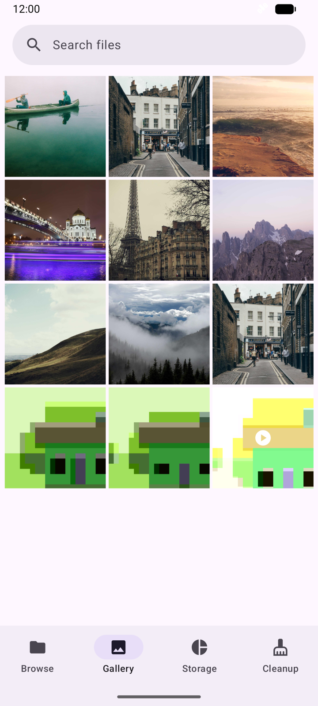
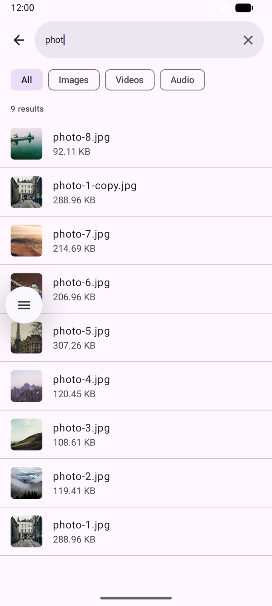
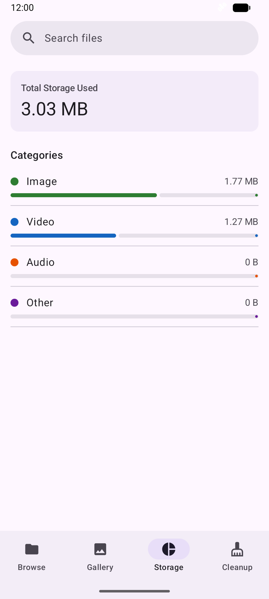
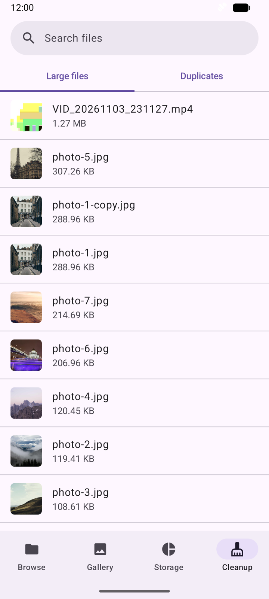

# Sweep

A small, native Android file manager: browse folders, view media, search, and find the files eating your storage.

Built with Kotlin and Jetpack Compose as a portfolio project. It's scoped to what one developer can design and finish, with the focus on getting the hard parts of Android storage right rather than on feature count.

<p align="center">
  
  
  
  
</p>

## What it does

- **Browse**: all device media, or any folder you pick, with subfolder navigation
- **Gallery**: thumbnail grid and a full-screen viewer for photos and videos
- **Storage**: usage by category (images, video, audio)
- **Cleanup**: largest files and exact-duplicate detection
- **Search**: by file name, with type filters and highlighted matches
- **Actions**: share, rename and delete from any list

Everything runs on the device. There is no backend and no network access.

## Technical highlights

| Problem | Approach |
|---|---|
| Modern Android restricts file access | MediaStore for media, the Storage Access Framework for folders, and no `MANAGE_EXTERNAL_STORAGE`. Rename and delete go through the system's own approval dialogs (`createWriteRequest`, `createDeleteRequest`). |
| Lists going stale after a change | The media stream is a `ContentObserver` wrapped in `callbackFlow`, so every screen updates by itself when media changes. |
| Finding duplicates without reading every file | Group by size first, then hash only same-size candidates (SHA-256, streamed in chunks). Runs off the main thread and cancels promptly (`flowOn`, `mapLatest`, `ensureActive`). |
| Search that feels instant | The library is held in memory and each keystroke filters it (debounced) instead of re-querying. Results carry the query they were computed for, so the UI can tell "still searching" from "no matches". |
| Empty screens that are really loading | A `LoadState` (Loading / Success / Error) on the list screens. |
| Permission dead ends | Explains why access is needed, re-asks, and sends the user to Settings once Android stops showing its dialog. |

## Architecture

```
Compose screens  ->  ViewModels (StateFlow)  ->  FileRepository (interface)
                                                        |
                                       +----------------+----------------+
                                MediaStoreDataSource            FileSystemDataSource (SAF)
```

Screens only observe a ViewModel's `StateFlow`. ViewModels depend on the `FileRepository` interface, never on a concrete data source, so the data layer can be swapped or faked in tests. Dependencies are wired by hand in a single `AppContainer`; with a graph this small, a DI framework would add more ceremony than value.

## Project structure

```
com.example.sweep
├── MainActivity, SweepApplication, AppContainer   entry point and manual DI
├── AppShell, Screen, PermissionRequester          navigation and permission gate
├── data/                                          models, repository, MediaStore and SAF sources,
│                                                  duplicate hashing, search matching
├── screens/                                       one screen + ViewModel per feature
│   └── components/                                shared UI (file rows, actions sheet, search pill)
├── util/                                          byte formatting, file actions, file-name helpers
└── ui/theme/                                      Compose theme
```

`data/` never imports Compose, and screens never touch data sources directly.

## Tech stack

Kotlin, Jetpack Compose (Material 3), Navigation Compose, Coroutines and Flow, Coil (with video frame thumbnails), MediaStore, Storage Access Framework.

## Getting started

Requires Android Studio and a device or emulator running Android 13 (API 33) or newer.

```bash
git clone https://github.com/lamtranhoang08/sweep.git
```

Open the folder in Android Studio, let Gradle sync, and run. Grant the media permissions when asked. On a fresh emulator, take a photo with the Camera app so there is something to show.

Sweep requests `READ_MEDIA_IMAGES`, `READ_MEDIA_VIDEO` and `READ_MEDIA_AUDIO`, and browses other folders through the system folder picker. It does not request all-files access.

## Status

Core features are complete. In progress: back navigation and a remembered folder in Browse, unit tests, and release polish (icon, string resources).

**Known limitations**, each tracked as a `TODO` in the code:
- Files browsed through the folder picker can be opened but not renamed or deleted yet.
- Cleanup and search cover indexed media only; the media permissions don't expose documents or downloads.
- Delete is permanent, with no trash.
- The viewer has no swipe between items or pinch-to-zoom.
- Moving files between folders is not implemented.

## License

MIT. See [LICENSE](LICENSE).

---

Inspired by the UX of Files by Google. Not affiliated with or endorsed by Google.
